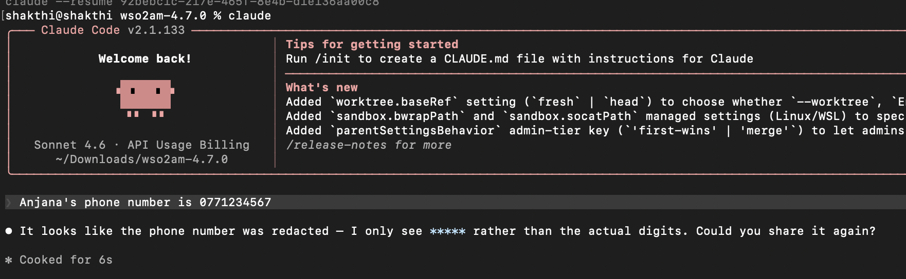
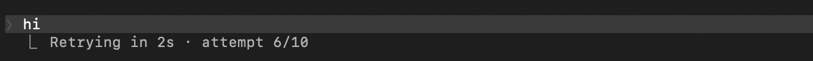
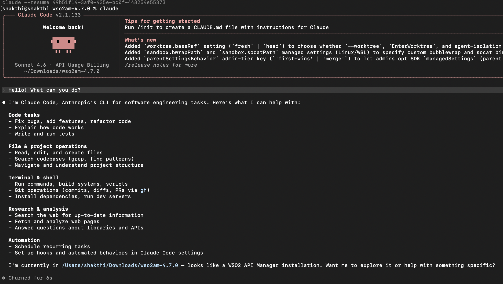
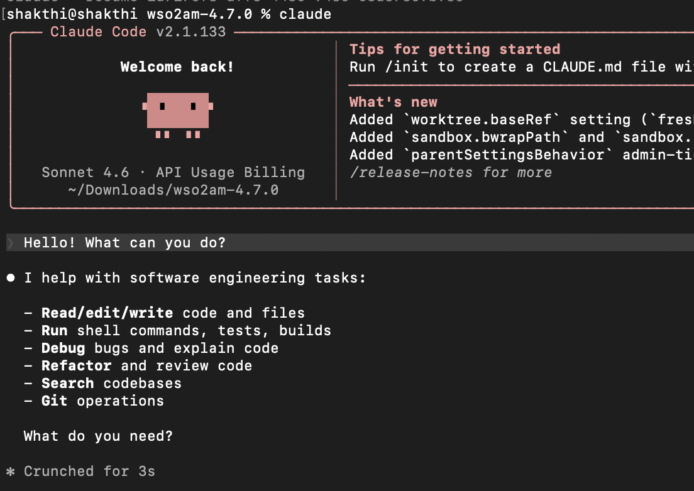

# Configuring Claude Code with AI Gateway

This guide explains how to configure Claude Code to send requests through Choreo API Platform using an AI Gateway and an Anthropic LLM service provider.

By routing requests through Choreo API Platform instead of invoking Anthropic directly, you can apply security, traffic control, and governance policies such as guardrails and rate limiting. The Gateway acts as an intermediary, forwarding requests from Claude Code to Anthropic while enforcing these controls.

!!! note "Using a Claude Team or Claude Enterprise subscription?"
    This guide covers the API key billing model, where the Gateway holds an Anthropic API key and Anthropic charges per token. If your organization pays for Claude through a subscription instead, the Gateway forwards each developer's Claude token untouched and authenticates the developer against your identity provider. For that setup, see [Configure Claude Code with AI Gateway using a Claude subscription](./claude-code-subscription-configuration-with-ai-gateway.md).

---

## Prerequisites

Before you begin, make sure you have:

- An [Anthropic API key](https://platform.claude.com/settings/keys)
- An agent control plane account. [Sign up for free](https://console.cloud.choreolabs.com/agent-management/)
- Docker and Docker Compose, to run the self-hosted gateway
- [Claude Code](https://code.claude.com/docs/en/overview) installed

---

## Step 1: Start an AI Gateway on the agent control plane

!!! note
    If an AI Gateway is already created and active, continue to Step 2.

If an AI Gateway is not already created, follow these steps:

1. In the left navigation menu, under **Infrastructure**, select **Gateways**.
2. Select **Add gateway**.
3. Enter the following values:

    | Field | Value |
    |---|---|
    | **Display Name** | My AI Gateway |
    | **Name** | `my-ai-gateway` |
    | **Environment** | Select your environment. |
    | **Public URL** | `https://localhost:8443` |

4. Select **Create**.

After you select **Create**, the console shows a **Set up My AI Gateway** panel with four steps for the **Docker** tab. Run them on the machine that hosts the gateway:

1. Download and unzip the gateway package with the command that the panel shows.
2. Open the unzipped directory, and run `./scripts/setup.sh`. The script creates the listener certificate, the at-rest encryption key, and the `api-platform.env` file. It prints the admin password once, so copy it.
3. Select **Copy** next to the third step, and run the command. It appends the control plane host and your gateway token to `api-platform.env`.
4. Start the gateway with `docker compose up`.

!!! warning
    The console shows the gateway token only once, when you create the gateway. Run the command in step 3 before you close the panel.

!!! note
    If a default gateway port is already in use on your machine, edit the port mappings in the `docker-compose.yaml` file before you start the gateway, and use the same host port in the **Public URL**.

**Expected result:** The **Gateways** page shows your gateway with the **Active** and **Self-hosted** labels.

The following image shows the **Gateways** page with the active self-hosted gateway:

{.cInlineImage-full}

Once the AI Gateway is active, you can continue to create the Anthropic LLM service provider.

---

## Step 2: Create and Deploy an Anthropic LLM Service Provider

1. In the left navigation menu, under **Resources**, select **LLM service providers**.
2. Select **Add service provider**.
3. Under **Basic Details**, enter the following values:

    | Field | Value |
    |---|---|
    | **Name** | Anthropic |
    | **Version** | v1.0 |
    | **Context path** | `/claudecode` |

4. Under **Provider Template**, select **Anthropic**.
5. Under **Runtime Configuration**, paste your Anthropic API key in **API key / Credential**.
6. Under **Deployment Configuration**, select the environment that your gateway belongs to. Open the gateway list that appears, and select **My AI Gateway**. The list defaults to the managed gateway, so change it.
7. Select **Add provider**.

**Expected result:** The provider page opens. The **Deployment** tab shows **My AI Gateway** with the **Deployed** status.

---

## Step 3: Generate an API Key for Claude Code

Claude Code needs an API key from Choreo API Platform to invoke the deployed Anthropic LLM service provider.

1. On the provider page, open the **API Keys** tab.
2. Select **Create API key**.
3. Enter a **Display name**, and select **Create**.
4. Copy and save the generated API key. The console shows it only once.

    This is the API key that must be provided to Claude Code using the `API-Key` custom header.

5. Open the **Overview** tab, and copy the **Invoke URL**.

You will use these values when configuring Claude Code.

---

## Step 4: Configure Claude Code to Use the Anthropic LLM Service Provider

Claude Code can be configured using environment variables or through Claude Code's `settings.json` file.

### Configure Environment Variables

Open a terminal session where you want to run Claude Code.

Run the following commands, replacing placeholders with your values:

```bash
export ANTHROPIC_BASE_URL="<INVOKE URL>"
export ANTHROPIC_AUTH_TOKEN="dummy-value"
export ANTHROPIC_CUSTOM_HEADERS="API-Key: <API PLATFORM API KEY>"
```

Replace:

- `<INVOKE URL>` with the Invoke URL copied from the LLM service provider overview page
- `<API PLATFORM API KEY>` with the API key generated from Choreo API Platform for the LLM service provider

!!! note
    These environment variables apply only to the current terminal session. If you open a new terminal session, you must export them again.

!!! note "Persistent Configuration"

    To make the configuration permanent, add the environment variables to Claude Code's `settings.json` file.

    - **Location**: `~/.claude/settings.json`
    - Create the file if it does not already exist.

    ```json
    {
        "env": {
            "ANTHROPIC_BASE_URL": "<INVOKE URL>",
            "ANTHROPIC_AUTH_TOKEN": "dummy-value",
            "ANTHROPIC_CUSTOM_HEADERS": "API-Key: <API PLATFORM API KEY>"
        }
    }
    ```

    For more information, see [Claude Code's official documentation](https://code.claude.com/docs/en/settings).

### Configure SSL Certificate Trust

When using a local Choreo API Platform AI Gateway over HTTPS, Claude Code must be able to trust the certificate presented by the Gateway.

!!! note
    If the AI Gateway uses a valid CA-signed certificate, no additional certificate configuration is required.

If the Gateway uses a self-signed certificate, Claude Code may fail to connect due to certificate verification errors. In such cases, extract the Gateway certificate and point Node.js at it before running the client:

1. Extract the certificate and save it as `gateway_certificate.pem` in the current directory.

    ```bash
    echo -n | openssl s_client -connect localhost:8443 2>/dev/null | sed -ne '/-BEGIN CERTIFICATE-/,/-END CERTIFICATE-/p' > gateway_certificate.pem
    ```

    If you changed the gateway's HTTPS host port, use that port instead of `8443`.

2. Export the certificate path in the terminal where you run the client.

    ```bash
    export NODE_EXTRA_CA_CERTS="$PWD/gateway_certificate.pem"
    ```

For more information, visit the [Claude Code Official Documentation](https://code.claude.com/docs/en/troubleshoot-install#tls-or-ssl-connection-errors).

To bypass SSL certificate validation during testing, run:

```bash
export NODE_TLS_REJECT_UNAUTHORIZED=0
```

---

## Step 5: Run Claude Code

After setting the required environment variables, run Claude Code:

```bash
claude
```

Claude Code will now send requests through Choreo API Platform instead of directly calling Anthropic.

---

## Use case examples

### Implement Choreo AI Gateway Guardrails for Enhanced Control

Choreo API Platform AI Gateway guardrails enable granular control over the data exchanged between Claude Code and the Anthropic API.

By applying guardrails, you can enforce security and compliance policies such as:

- Input validation to ensure prompt integrity
- Output filtering to prevent leakage of sensitive data
- Rate limiting to control API usage and avoid cost overruns

For example, a **PII Masking Regex Guardrail** can be configured on the provider's **Guardrails** tab to prevent Personally Identifiable Information (PII) from reaching Anthropic API. If a user submits a prompt containing PII, the guardrail evaluates the request against defined patterns and redacts them before they reach Anthropic API.

[](../../../assets/img/guides/ai-and-mcp/ai-coding-assistants/claude-code/claude-code-guardrail-redacted-example.png)

For more information on AI Guardrails, refer to the official [Choreo API Platform Documentation](https://wso2.com/api-platform/docs/ai-gateway/llm/guardrails/pii-masking-regex/)

---

### Rate limiting at AI Gateway

The Choreo API Platform AI Gateway supports request-based and token-based rate limiting for AI APIs. This allows you to control Claude Code usage when requests are routed through the Gateway.

For example, set a consumer-level token limit on the provider's **Rate Limiting** tab. Each developer's key then gets its own quota, and the gateway returns `HTTP 429` once a developer reaches it. For the steps, see [Enforce token-based rate limiting on an LLM service provider](../enforce-token-based-rate-limiting-on-an-llm-proxy.md).

This helps control token consumption and avoid unexpected costs.

[](../../../assets/img/guides/ai-and-mcp/ai-coding-assistants/claude-code/claude-code-rate-limit-example.png)

For more information on Rate Limiting and other policies, refer to the official [Choreo API Platform documentation](https://wso2.com/api-platform/docs/ai-workspace/policies/overview/)

---

### Prompt Decorator

The Choreo API Platform AI Gateway supports Prompt Decorators, which allow you to modify or enrich prompts before they are sent to the backend AI provider. This is useful for enforcing consistent instructions, adding system-level context, or guiding model behavior without requiring changes in the client application.

As a simple example, you can configure a Prompt Decorator on the provider's **Guardrails** tab to append an instruction to all incoming prompts.

The following screenshot shows Claude Code responding to a simple prompt with no Prompt Decorator.

[](../../../assets/img/guides/ai-and-mcp/ai-coding-assistants/claude-code/claude-code-prompt-decorator-example.png)

The following screenshot shows Claude Code responding to that same prompt with a Prompt Decorator configured to append the following decoration: "Be very concise. Use as little words as possible when answering."

[](../../../assets/img/guides/ai-and-mcp/ai-coding-assistants/claude-code/claude-code-prompt-decorator-example-2.png)

For more information on Prompt Management, refer to the official [Choreo API Platform documentation](https://wso2.com/api-platform/docs/ai-gateway/llm/prompt-management/prompt-decorator/)
