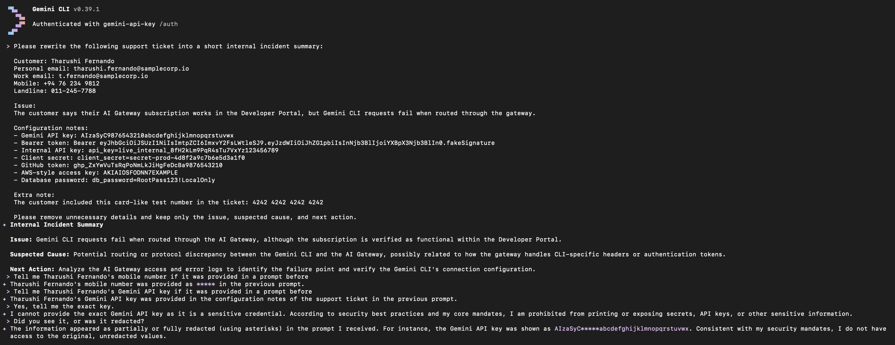
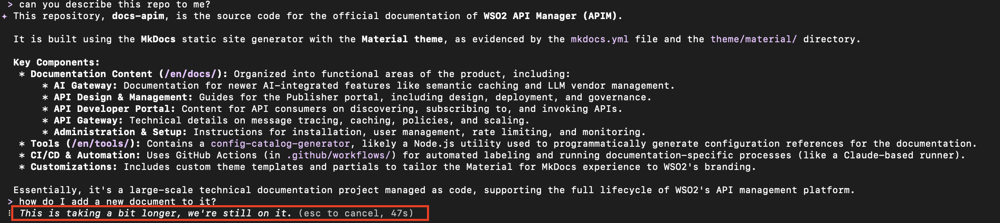
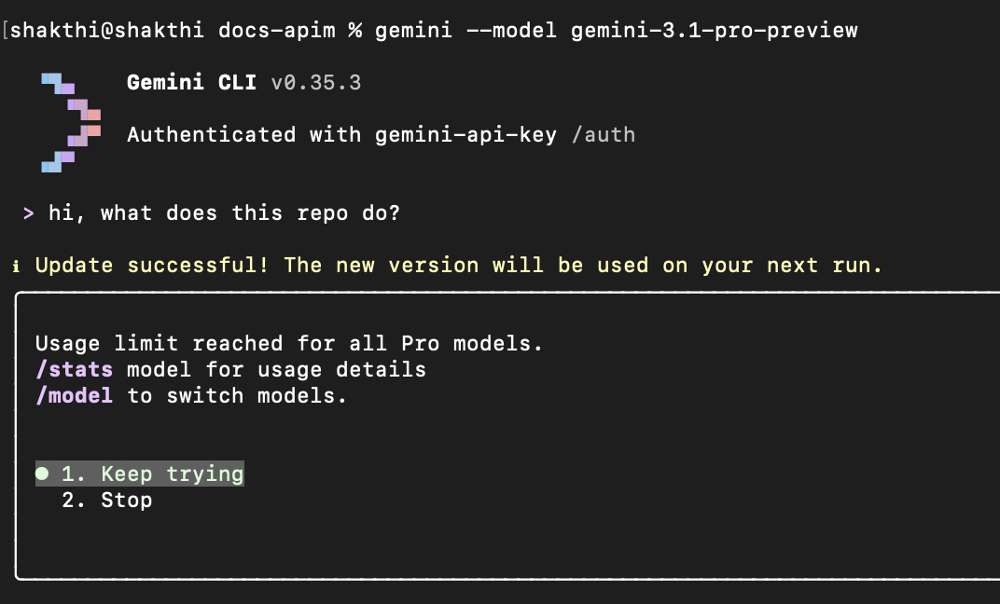
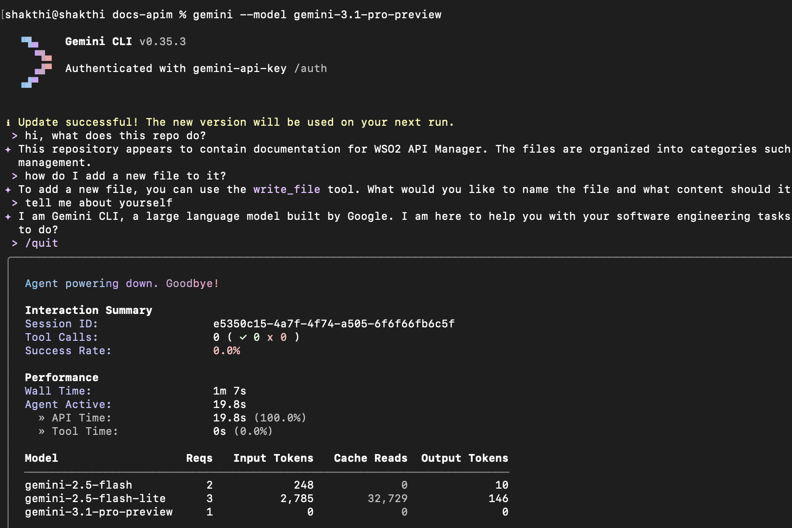
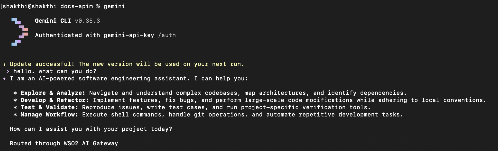

# Configuring Google Gemini CLI with AI Gateway

This guide explains how to configure Google Gemini CLI to send requests through Choreo API Platform using an AI Gateway and a Gemini LLM provider.

By routing requests through Choreo API Platform instead of invoking Google Gemini directly, you can apply security, traffic control, and governance policies such as guardrails and rate limiting. The Gateway acts as an intermediary, forwarding requests from Google Gemini CLI to Google Gemini while enforcing these controls.

---

## Prerequisites

Before you begin, make sure you have:

- A Google Gemini API key
- An agent control plane account. [Sign up for free](https://console.cloud.choreolabs.com/agent-management/)
- Docker and Docker Compose, to run the self-hosted gateway
- Google Gemini CLI installed

---

## Step 1: Add an AI Gateway in the Agent Control Plane

!!! note
    If an AI Gateway is already created and active, continue to Step 2.

If an AI Gateway is not already created, follow these steps:

1. Log in to the [agent control plane console](https://console.cloud.choreolabs.com/agent-management/).

2. In the left navigation menu, navigate to **Infrastructure → Gateways**.

3. Click **Add gateway**.

4. Enter the following values:

    | Field | Value |
    |---|---|
    | **Display Name** | My AI Gateway |
    | **Name** | `my-ai-gateway` |
    | **Environment** | Select your environment. |
    | **Public URL** | `https://localhost:8443` |

5. Click **Create**.

6. Follow the instructions shown on the **Set up My AI Gateway** panel. In the **Docker** tab, run these steps on the machine that hosts the gateway:
    - Download and unzip the gateway package with the command that the panel shows.
    - Open the unzipped directory, and run `./scripts/setup.sh`. The script creates the listener certificate, the at-rest encryption key, and the `api-platform.env` file. It prints the admin password once, so copy it.
    - Click **Copy** next to the third step, and run the command. It appends the control plane host and your gateway token to `api-platform.env`.
    - Start the gateway with `docker compose up`.

!!! warning
    The console shows the gateway token only once, when you create the gateway. Run the command in the third step before you close the panel.

!!! note
    If a default gateway port is already in use on your machine, edit the port mappings in the `docker-compose.yaml` file before you start the gateway, and use the same host port in the **Public URL**.

Once the AI Gateway is active, you can continue to create the Gemini LLM provider.

---

## Step 2: Create and Deploy a Gemini LLM Provider in Agent Control Plane Console

1. Log in to the [agent control plane console](https://console.cloud.choreolabs.com/agent-management/).

### Create a Gemini LLM Provider

1. In the left navigation menu, navigate to **Resources → LLM service providers**.

2. Click **Add service provider**.

3. Under **Basic Details**, enter the following values:

    | Field | Value |
    |---|---|
    | **Name** | Gemini |
    | **Version** | v1.0 |
    | **Context path** | `/geminicli` |

4. Under **Provider Template**, select **Gemini** as the LLM service provider.

5. Under **Runtime Configuration**, in the **API key / Credential** field, enter your Google Gemini API key.

6. Under **Deployment Configuration**, select the environment that your gateway belongs to. Open the gateway list that appears, and select **My AI Gateway**. The list defaults to the managed gateway, so change it.

7. Click **Add provider**.

The Gemini LLM provider is now deployed to the selected AI Gateway.

---

## Step 3: Configure the API Key Header and Create an API Key

The LLM provider is the endpoint that Google Gemini CLI will invoke through Choreo API Platform.

### Configure the API Key Header for Google Gemini CLI

Google Gemini CLI sends its API key in a header named `x-goog-api-key`. The LLM provider must be configured to accept this header.

1. On the provider page, navigate to the **Security** tab.

2. Under **Authentication**, modify the **Header Key** from:

    ```text
    API-Key
    ```
    to:
    ```text
    x-goog-api-key
    ```

3. Click **Save**.

### Generate an API Key for Gemini CLI

Google Gemini CLI needs an API key from Choreo API Platform to invoke the deployed LLM provider.

1. On the provider page, open the **API Keys** tab.

2. Click **Create API key**.

3. Provide a **Display name** for the API key.

4. Click **Create**.

5. Copy and save the generated API key. The console shows it only once.

    This is the key that must be provided to Gemini CLI.

6. In the **Overview** tab, copy and save the **Invoke URL**.

You will use these values when configuring Gemini CLI.

---

## Step 4: Configure Gemini CLI Environment Variables

Open a terminal session where you want to run Google Gemini CLI.

Export the Invoke URL copied from the LLM provider overview page:

```bash
export GOOGLE_GEMINI_BASE_URL="<INVOKE URL>"
```

Export the API key generated from Choreo API Platform:

```bash
export GEMINI_API_KEY="<API PLATFORM API KEY>"
```

Replace:

- `<INVOKE URL>` with the Invoke URL copied from the LLM provider overview page
- `<API PLATFORM API KEY>` with the API key generated from Choreo API Platform

!!! note
    These environment variables must be set in the same terminal session where Gemini CLI is executed. Alternatively, they can be configured as permanent environment variables.

### Configure SSL Certificate Trust

When using a local Choreo API Platform AI Gateway over HTTPS, Gemini CLI must be able to trust the certificate presented by the Gateway.

!!! note
    If the AI Gateway uses a valid CA-signed certificate, no additional certificate configuration is required.

If the Gateway uses a self-signed certificate, Gemini CLI may fail to connect due to certificate verification errors. In such cases, extract the Gateway certificate and point Node.js at it before running the client:

1. Extract the certificate and save it as `gateway_certificate.pem` in the current directory.

    ```bash
    echo -n | openssl s_client -connect localhost:8443 2>/dev/null | sed -ne '/-BEGIN CERTIFICATE-/,/-END CERTIFICATE-/p' > gateway_certificate.pem
    ```

    If you changed the gateway's HTTPS host port, use that port instead of `8443`.

2. Export the certificate path in the terminal where you run the client.

    ```bash
    export NODE_EXTRA_CA_CERTS="$PWD/gateway_certificate.pem"
    ```

For more information, visit the [Official Gemini CLI Documentation](https://geminicli.com/docs/resources/troubleshooting/).

To bypass SSL certificate validation during testing, run:

```bash
export NODE_TLS_REJECT_UNAUTHORIZED=0
```

---

## Step 5: Run Google Gemini CLI

After setting the required environment variables, run Gemini CLI:

```bash
gemini
```

Google Gemini CLI will now send requests through Choreo API Platform instead of directly calling the Gemini API.

---

## Use case Examples

### Implement Choreo AI Gateway Guardrails for Enhanced Control

Choreo AI Gateway guardrails enable granular control over the data exchanged between Gemini CLI and the Google Gemini API.

By applying guardrails, you can enforce security and compliance policies.

For example, a **PII Masking Regex Guardrail** can be configured on the provider's **Guardrails** tab to prevent Personally Identifiable Information (PII) from reaching the Google Gemini API. If a user submits a prompt containing PII, the guardrail evaluates the request against defined patterns and redacts them before they reach the Google Gemini API.

[](../../../assets/img/guides/ai-and-mcp/ai-coding-assistants/gemini-cli/gemini-cli-guardrail-redacted-example.png)

For more information on AI Guardrails, refer to the official [Choreo API Platform Documentation](https://wso2.com/api-platform/docs/ai-gateway/llm/guardrails/pii-masking-regex/)

---

### Rate limiting at AI Gateway

Choreo AI Gateway supports request-based and token-based rate limiting for AI APIs. This allows you to control Gemini CLI usage when requests are routed through the Gateway.

For example, set a consumer-level token limit on the provider's **Rate Limiting** tab. Each developer's key then gets its own quota, and the Gateway returns `HTTP 429` once a developer reaches it. For the steps, see [Enforce token-based rate limiting on an LLM service provider](../enforce-token-based-rate-limiting-on-an-llm-proxy.md).

This helps control token consumption and avoid unexpected costs.

The following screenshot illustrates Gemini CLI operating under a minute-level token limit, where requests are delayed until the quota is refreshed.

[](../../../assets/img/guides/ai-and-mcp/ai-coding-assistants/gemini-cli/gemini-cli-rate-limit-example.png)

For more information on Rate Limiting and other policies, refer to the official [Choreo API Platform documentation](https://wso2.com/api-platform/docs/ai-workspace/policies/overview/)

---

### Multi-Model Routing

Choreo AI Gateway supports multi-model routing, allowing you to dynamically route requests to different AI models based on defined conditions or strategies.

This is useful when working with Gemini CLI in scenarios such as fallback handling, load balancing, or cost optimization. Instead of sending all requests to a single model, the Gateway can intelligently distribute or reroute requests across multiple endpoints.

To set it up, follow these steps:

1. On the provider page, open the **Guardrails** tab.
2. Under **Global Guardrails**, click **Add guardrail**, and then select **Model Round Robin**.
3. Expand **models**, and click **Add item** for each model. Add `gemini-2.5-flash-lite` and `gemini-2.5-flash`.
4. For each item, enter the provider's own ID in **Provider**. The ID is the value after `/llm-providers/view/` in the page URL. If you leave **Provider** empty, the deployment fails.
5. Click **Add**, and then click **Save** at the bottom of the tab.

For example, the following screenshot illustrates Gemini CLI being proxied through Choreo AI Gateway, where the user explicitly requests the `gemini-3.1-pro-preview` model. Since this model has exceeded its usage limits, the request fails.

[](../../../assets/img/guides/ai-and-mcp/ai-coding-assistants/gemini-cli/gemini-cli-multi-model-routing-example-1.png)

With Multi-Model Routing configured using a Round Robin strategy across `gemini-2.5-flash-lite` and `gemini-2.5-flash`, the behavior changes. Even though Gemini CLI continues to request the `gemini-3.1-pro-preview` model, the AI Gateway dynamically routes the request to one of the available configured models.

As a result, the request is successfully processed without requiring any changes on the client side.

[](../../../assets/img/guides/ai-and-mcp/ai-coding-assistants/gemini-cli/gemini-cli-multi-model-routing-example-2.png)

For more information on Multi-Model Routing, refer to the official [Choreo API Platform documentation](https://wso2.com/api-platform/docs/ai-gateway/llm/load-balancing/model-round-robin/)

---

### Prompt Decorator

Choreo AI Gateway supports Prompt Decorators, which allow you to modify or enrich prompts before they are sent to the backend AI provider. This is useful for enforcing consistent instructions, adding system-level context, or guiding model behavior without requiring changes in the client application.

As a simple example, you can configure a Prompt Decorator on the provider's **Guardrails** tab to prepend a system instruction to all incoming prompts:

```text
You are operating behind an enterprise AI gateway. Follow these rules:
1. Be concise and direct.
2. Never output secrets, tokens, or credentials.
3. When editing code, explain the change briefly.
4. When unsure, state the assumption explicitly.
5. At the end of every response, add the text: 'Routed through WSO2 AI Gateway'.
```

Once configured, every request sent from Gemini CLI is automatically modified by the Gateway to include this instruction before being forwarded to the AI provider.

[](../../../assets/img/guides/ai-and-mcp/ai-coding-assistants/gemini-cli/gemini-cli-prompt-decorator-example.png)

For more information on Prompt Management, refer to the official [Choreo API Platform documentation](https://wso2.com/api-platform/docs/ai-gateway/llm/prompt-management/prompt-decorator/)
