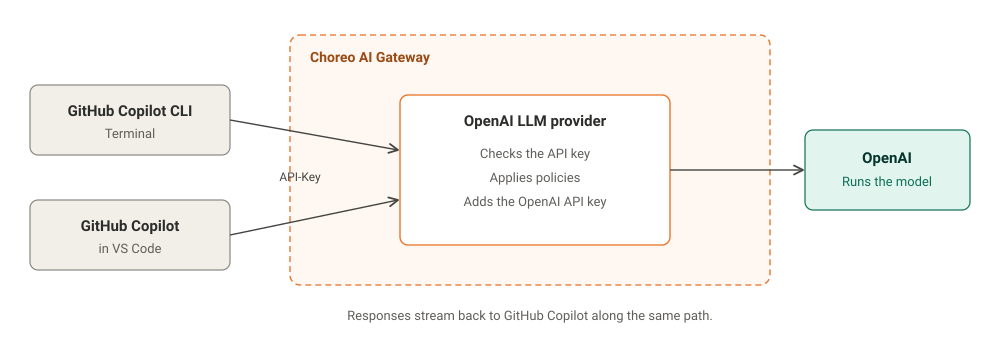
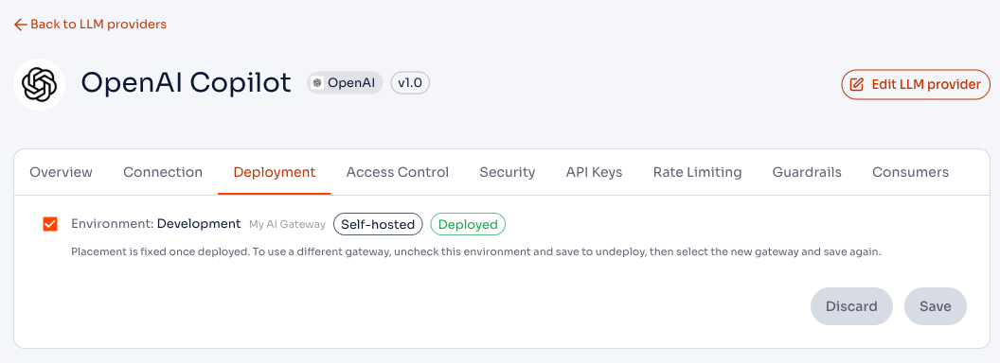
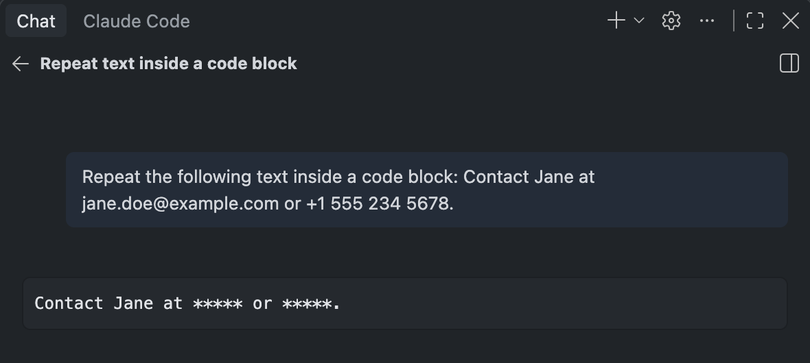
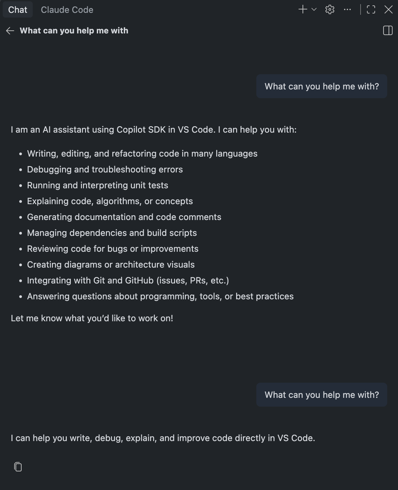

# Configuring GitHub Copilot with AI Gateway

## Overview

GitHub Copilot uses GitHub-hosted models by default. Its bring your own key (BYOK) option lets you point GitHub Copilot at a model provider of your choice instead.

This guide shows you how to use BYOK to route GitHub Copilot requests through the Choreo AI Gateway to OpenAI. When developers connect GitHub Copilot to OpenAI directly, each developer needs the OpenAI API key, and there is no central place to control or track how GitHub Copilot is used. By the end, you'll have GitHub Copilot sending requests to an LLM provider on the Choreo AI Gateway, where each request is authenticated with a Choreo API Platform API key, and governed by the policies you attach.

The guide covers two GitHub Copilot clients.

- **GitHub Copilot CLI**, the terminal assistant
- **GitHub Copilot in Visual Studio Code (VS Code)**, using Copilot Chat

## Learning objectives

- Route GitHub Copilot requests to OpenAI through an LLM provider, so developers use a Choreo API Platform API key and never handle the OpenAI API key
- Configure GitHub Copilot CLI and GitHub Copilot in VS Code to send requests to a custom endpoint using BYOK
- Set up SSL certificate trust so GitHub Copilot can connect to an AI Gateway that uses a self-signed certificate
- Control GitHub Copilot usage by attaching guardrail, rate limit, and prompt decorator policies to the LLM provider

## Key concepts

This guide uses the following terms.

- *Agent control plane* is where you create and manage AI Gateways, LLM providers, and the policies attached to them.
- *AI Gateway* is the runtime that receives requests from GitHub Copilot and enforces the policies attached to the LLM provider. This guide uses a self-hosted gateway.
- *LLM provider* is a registered connection to a model provider, such as OpenAI. It stores the provider's API key, so developers don't need it, and it's where you attach policies.
- *Policy* is a rule that the AI Gateway applies to each request, such as a guardrail, a rate limit, or a prompt decorator.
- *Bring your own key (BYOK)* is the GitHub Copilot option that sends requests to a model provider you configure instead of to GitHub-hosted models. In VS Code, a model added this way is called a custom endpoint model.

---

## How the request flow works

When a developer selects a model configured with BYOK, GitHub Copilot sends the chat and agent requests for that model to the URL configured for the model, instead of to GitHub-hosted models. In this setup, that URL is the invoke URL of an LLM provider deployed on the Choreo AI Gateway.

The following diagram shows how a GitHub Copilot request travels through the Choreo AI Gateway.

[](../../../assets/img/guides/ai-and-mcp/ai-coding-assistants/github-copilot/request-flow.svg)

1. **GitHub Copilot to the LLM provider.** GitHub Copilot CLI or GitHub Copilot in VS Code sends the request to the LLM provider, with the Choreo API Platform API key in the `API-Key` header.
2. **Policy enforcement.** The AI Gateway checks the API key and applies the policies attached to the LLM provider, such as guardrails, rate limits, and prompt decorators.
3. **Forwarding to OpenAI.** The OpenAI LLM provider adds the OpenAI API key and forwards the request to OpenAI.
4. **Response.** OpenAI streams the response back through the Choreo AI Gateway to GitHub Copilot.

This setup provides the following benefits.

- Developers never hold the OpenAI API key. The key is stored only in the OpenAI LLM provider.
- Each developer or team can use a separate Choreo API Platform API key, which you can revoke without affecting others.
- You can add or change policies at the Choreo AI Gateway without changing GitHub Copilot settings.

---

## Prerequisites

Before you begin, make sure you have the following.

- An agent control plane account. [Sign up for free](https://console.cloud.choreolabs.com/agent-management/).
- Docker and Docker Compose, to run the self-hosted gateway
- An [OpenAI API key](https://platform.openai.com/api-keys)
- One of the following GitHub Copilot clients:
    - [GitHub Copilot CLI](https://docs.github.com/en/copilot/how-tos/copilot-cli/set-up-copilot-cli/install-copilot-cli) installed
    - [VS Code](https://code.visualstudio.com/) with GitHub Copilot installed

!!! note "Using a GitHub Copilot Business or Enterprise plan with VS Code?"
    Your organization administrator must enable the **Bring Your Own Language Model Key in VS Code** policy. For more information, see the [VS Code language models documentation](https://code.visualstudio.com/docs/agent-customization/language-models).

---

## Step 1: Start an AI Gateway in the agent control plane

!!! note
    If an AI Gateway is already created and active, continue to Step 2.

1. Log in to the [agent control plane console](https://console.cloud.choreolabs.com/agent-management/).

2. In the left navigation panel, under **Infrastructure**, click **Gateways**.

3. Click **Add gateway**.

4. Enter the following values:

    | Field | Value |
    |---|---|
    | **Display Name** | My AI Gateway |
    | **Name** | `my-ai-gateway` |
    | **Environment** | Select your environment. |
    | **Public URL** | `https://localhost:8443` |

5. Click **Create**.

6. Follow the instructions shown on the **Set up My AI Gateway** panel to download, configure, and start the gateway. In the **Docker** tab, run these steps on the machine that hosts the gateway:
    - Download and unzip the gateway package with the command that the panel shows.
    - Open the unzipped directory, and run `./scripts/setup.sh`. The script creates the listener certificate, the at-rest encryption key, and the `api-platform.env` file. It prints the admin password once, so copy it.
    - Click **Copy** next to the third step, and run the command. It appends the control plane host and your gateway token to `api-platform.env`.
    - Start the gateway with `docker compose up`.

!!! warning
    The console shows the gateway token only once, when you create the gateway. Run the command in the third step before you close the panel.

!!! note
    If a default gateway port is already in use on your machine, edit the port mappings in the `docker-compose.yaml` file before you start the gateway, and use the same host port in the **Public URL**.

Once the gateway status shows as **Active**, continue to Step 2. The following screenshot shows an active AI Gateway.

[](../../../assets/img/guides/ai-and-mcp/agent-control-plane/gateways-list-active.png)

---

## Step 2: Create and deploy an OpenAI LLM provider

1. In the left navigation panel, under **Resources**, click **LLM service providers**.

2. Click **Add service provider**.

3. Under **Basic Details**, enter the following values:

    | Field | Value |
    |---|---|
    | **Name** | OpenAI Copilot |
    | **Version** | v1.0 |
    | **Context path** | `/copilot` |

    !!! note
        The Console builds the provider ID from the name, so each provider in an organization needs a different name. If you already created a provider named `OpenAI`, use another name, such as `OpenAI Copilot`.

4. Under **Provider Template**, select **OpenAI** as the LLM service provider.

5. Under **Runtime Configuration**, in the **API key / Credential** field, enter your OpenAI API key.

6. Under **Deployment Configuration**, select the environment that your gateway belongs to. Open the gateway list that appears, and select **My AI Gateway**. The list defaults to the managed gateway, so change it.

7. Click **Add provider**.

The OpenAI LLM provider is now deployed to the selected AI Gateway, as shown in the following screenshot.

[](../../../assets/img/guides/ai-and-mcp/agent-control-plane/openai-copilot-provider-deployed.png)

---

## Step 3: Create an API key for GitHub Copilot

The LLM provider is the endpoint that GitHub Copilot invokes through Choreo API Platform.

GitHub Copilot needs an API key from Choreo API Platform to invoke the deployed LLM provider.

1. On the provider page, open the **API Keys** tab.

2. Click **Create API key**.

3. Provide a **Display name** for the API key.

4. Click **Create**.

5. Copy and save the generated API key. The console shows it only once.

    This is the API key that must be provided to GitHub Copilot using the `API-Key` custom header.

6. In the **Overview** tab, copy and save the **Invoke URL**.

You use these values when configuring GitHub Copilot.

---

## Step 4: Configure SSL certificate trust

When using a local Choreo AI Gateway over HTTPS, GitHub Copilot must be able to trust the certificate presented by the gateway.

If the AI Gateway uses a certificate signed by a trusted certificate authority (CA), skip this step.

If the gateway uses a self-signed certificate, add the gateway certificate to your operating system's trust store. GitHub Copilot CLI and VS Code both use this trust store by default.

1. Extract the gateway certificate and save it as `gateway_certificate.pem` in the current directory.

    ```bash
    echo -n | openssl s_client -connect localhost:8443 2>/dev/null | sed -ne '/-BEGIN CERTIFICATE-/,/-END CERTIFICATE-/p' > gateway_certificate.pem
    ```

    On Windows, run this command in Git Bash.

2. Add the certificate to your operating system's trust store.

    === "macOS"

        ```bash
        security add-trusted-cert -r trustRoot -k ~/Library/Keychains/login.keychain-db gateway_certificate.pem
        ```

    === "Linux (Ubuntu or Debian)"

        ```bash
        sudo cp gateway_certificate.pem /usr/local/share/ca-certificates/gateway_certificate.crt
        sudo update-ca-certificates
        ```

    === "Windows (PowerShell)"

        ```powershell
        certutil -user -addstore Root gateway_certificate.pem
        ```

3. Restart VS Code if it is open, and open a new terminal window before you run GitHub Copilot CLI.

    !!! note "Errors without this step"
        Without the certificate in the trust store, VS Code reports `net::ERR_CERT_AUTHORITY_INVALID`, and GitHub Copilot CLI reports `The certificate was not trusted` or `The validity period in the certificate exceeds the maximum allowed`. Setting `NODE_EXTRA_CA_CERTS` does not fix the GitHub Copilot CLI error.

For more information about VS Code, see the [VS Code network connections documentation](https://code.visualstudio.com/docs/setup/network).

!!! note "Local testing only"
    For local testing only, you can use the gateway's HTTP endpoint instead of the Invoke URL, for example `http://localhost:8080/<PROVIDER CONTEXT PATH>`. Do not use HTTP in production, because the API key and prompts are sent unencrypted.

---

## Step 5: Connect GitHub Copilot to the LLM provider

Follow the option for the GitHub Copilot client you use.

### Option 1: GitHub Copilot CLI

GitHub Copilot CLI reads its model provider settings from environment variables.

#### Configure environment variables

Open a terminal session where you want to run GitHub Copilot CLI.

Run the following commands, replacing the placeholders with your values.

```bash
export COPILOT_PROVIDER_TYPE="openai"
export COPILOT_PROVIDER_BASE_URL="<INVOKE URL>"
export COPILOT_PROVIDER_HEADERS="API-Key: <API PLATFORM API KEY>"
export COPILOT_MODEL="gpt-4.1"
```

Replace the placeholders as follows.

- `<INVOKE URL>` with the Invoke URL copied from the LLM provider overview page
- `<API PLATFORM API KEY>` with the API key generated from Choreo API Platform for the LLM provider

!!! note
    `COPILOT_MODEL` must be a model that the LLM provider supports, such as `gpt-4.1` for OpenAI. GitHub Copilot CLI also requires the model to support tool calling and streaming. For more information, see [GitHub Copilot CLI's official documentation](https://docs.github.com/en/copilot/how-tos/copilot-cli/customize-copilot/use-byok-models).

!!! note
    These environment variables apply only to the current terminal session. To make the configuration permanent, add them to your shell profile, such as `~/.zshrc` or `~/.bashrc`.

#### Run GitHub Copilot CLI

After setting the required environment variables, run GitHub Copilot CLI.

```bash
copilot
```

GitHub Copilot CLI sends requests through Choreo API Platform instead of directly calling OpenAI.

### Option 2: GitHub Copilot in VS Code

Copilot Chat in VS Code connects to the LLM provider as a custom endpoint model.

#### Add the LLM provider as a custom endpoint

1. In VS Code, open the **Chat** view.

2. Open the model picker and click **Manage Language Models**.

    You can also run **Chat: Manage Language Models** from the Command Palette.

3. Click **Add Models**, and then select **Custom Endpoint**.

4. Provide a group name for the models. For example, `Choreo AI Gateway`.

5. Provide a display name, and enter the API key generated from Choreo API Platform for the LLM provider.

6. Select **Chat Completions** as the API type.

    VS Code opens the `chatLanguageModels.json` file.

7. In `chatLanguageModels.json`, fill in the empty `id`, `name`, and `url` fields of the model entry, and add a `requestHeaders` field. Keep the other values that VS Code generated.

    ```json
    {
      "id": "gpt-4.1",
      "name": "GPT-4.1 (Choreo AI Gateway)",
      "url": "<INVOKE URL>/chat/completions",
      "toolCalling": true,
      "vision": true,
      "maxInputTokens": 128000,
      "maxOutputTokens": 16000,
      "requestHeaders": {
        "API-Key": "${apiKey}"
      }
    }
    ```

    Replace `<INVOKE URL>` with the Invoke URL copied from the LLM provider overview page. The `requestHeaders` field sends the Choreo API Platform API key using the `API-Key` custom header.

8. Save the file.

#### Use Copilot Chat with the LLM provider

1. Open the **Chat** view in VS Code.

2. In the model picker, under **Other Models**, select **GPT-4.1 (Choreo AI Gateway)**.

3. Send a prompt.

Copilot Chat sends requests through Choreo API Platform instead of directly calling OpenAI.

!!! note
    The Choreo AI Gateway governs the GitHub Copilot requests that use the model you configure in this guide. Other GitHub Copilot features continue to use GitHub's services. The bring your own key (BYOK) options in GitHub Copilot are controlled by GitHub and might change. For the latest information, see the [GitHub Copilot CLI documentation](https://docs.github.com/en/copilot/how-tos/copilot-cli/customize-copilot/use-byok-models) and the [VS Code language models documentation](https://code.visualstudio.com/docs/agent-customization/language-models).

---

## Use case examples

### Apply guardrails

Choreo AI Gateway guardrails enable granular control over the data exchanged between GitHub Copilot and the OpenAI API.

By applying guardrails, you can enforce security and compliance policies such as the following.

- Input validation to ensure prompt integrity
- Output filtering to prevent leakage of sensitive data
- Rate limiting to control API usage and avoid cost overruns

For example, you can configure a **PII Masking Regex Guardrail** on the provider's **Guardrails** tab to prevent Personally Identifiable Information (PII) from reaching the OpenAI API. If a user submits a prompt containing PII, the guardrail evaluates the request against defined patterns and redacts them before they reach the OpenAI API.

The following screenshot shows Copilot Chat in VS Code responding to a prompt that contains an email address and a phone number, with the PII Masking Regex Guardrail configured to redact PII.

[](../../../assets/img/guides/ai-and-mcp/ai-coding-assistants/github-copilot/guardrail-pii-redacted.png)

For more information, see [PII masking regex guardrail](https://wso2.com/api-platform/docs/ai-gateway/llm/guardrails/pii-masking-regex/).

---

### Limit request rates

Choreo AI Gateway supports request-based and token-based rate limiting for AI APIs. This allows you to control GitHub Copilot usage when requests are routed through the gateway.

For example, set a consumer-level token limit on the provider's **Rate Limiting** tab. Each developer's key then gets its own quota, and the gateway returns `HTTP 429` once a developer reaches it. For the steps, see [Enforce token-based rate limiting on an LLM service provider](../enforce-token-based-rate-limiting-on-an-llm-proxy.md).

This helps control token consumption and avoid unexpected costs.

The following screenshot shows GitHub Copilot CLI receiving a rate limit response after the configured limit is reached.

[](../../../assets/img/guides/ai-and-mcp/ai-coding-assistants/github-copilot/rate-limit-exceeded.png)

For more information, see [Policies overview](https://wso2.com/api-platform/docs/ai-workspace/policies/overview/).

---

### Add instructions with a prompt decorator

Choreo AI Gateway supports Prompt Decorators, which allow you to modify or enrich prompts before they are sent to the backend AI provider. This is useful for enforcing consistent instructions, adding system-level context, or guiding model behavior without requiring changes in the client application.

For example, you can configure a Prompt Decorator on the provider's **Guardrails** tab to append an instruction to every prompt.

The following screenshot shows Copilot Chat in VS Code responding to the same prompt twice. The first response is without a Prompt Decorator. The second response is with a Prompt Decorator configured to append the following decoration: "Answer in one short sentence."

[](../../../assets/img/guides/ai-and-mcp/ai-coding-assistants/github-copilot/prompt-decorator-before-after.png)

For more information, see [Prompt decorator](https://wso2.com/api-platform/docs/ai-gateway/llm/prompt-management/prompt-decorator/).
