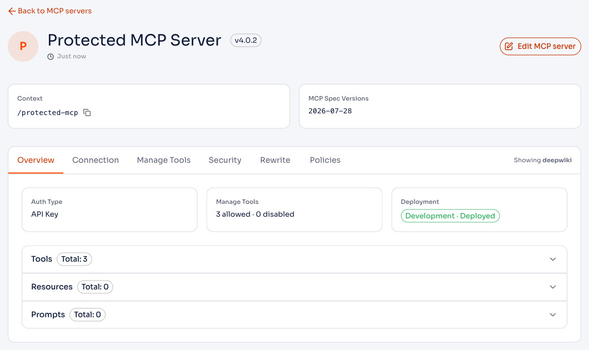
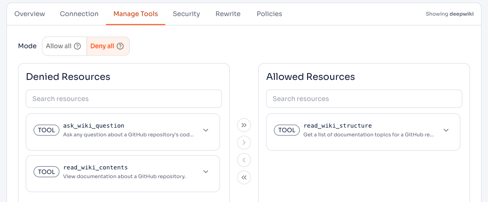

# Reduce MCP tool poisoning risk with the MCP Access Control policy

## Overview

MCP tool poisoning is a prompt-injection technique. A malicious or compromised MCP server embeds malicious instructions in tool metadata, such as a tool's `description` field. An MCP client may pass that metadata to an LLM. A person reviewing a tool list in a UI can easily miss wording that a model still reads. This guide explains what tool poisoning is and why it's a real risk for any agent connected to an MCP server you don't fully control. It also explains how setting the **MCP Access Control** rule on an **MCP server** in the agent control plane reduces your exposure to it.

The MCP Access Control policy is one layer of defense, not a complete solution. It's described precisely in that context throughout this guide.

The walkthrough below uses a clean public reference server so that you can follow the configuration and filtering flow without interacting with intentionally malicious tool definitions. In this walkthrough, the trusted tool is allowlisted to demonstrate how the gateway evaluates and permits approved tools.

To see the same controls applied to an intentionally poisoned tool, use the [companion sample](#try-the-sample). The sample runs locally and includes a poisoned tool definition so you can observe the gateway detecting and filtering it out.

## What is MCP tool poisoning?

The Model Context Protocol (MCP) lets a client discover a server's tools by calling `tools/list`. Each tool definition in the response includes a `name` and can include a human-readable `description` and other metadata such as `annotations`, all supplied by the server. The `description` is meant to tell a person or a model what the tool does and when to use it.

MCP itself doesn't specify whether, when, or how often a client passes that description to the underlying model. That's a client or host implementation choice, not a protocol requirement. The MCP specification explicitly requires clients to treat tool annotations as untrusted unless they come from trusted servers. More generally, server-supplied tool metadata should not automatically be treated as trusted instructions. If a client incorporates a malicious tool description into the model's context, that text can become a prompt-injection vector. Tool poisoning is what happens when server-supplied tool metadata is weaponized. A malicious or compromised server embeds directives in it, such as instructions to read a local file, ignore a previous rule, or send data somewhere. These directives are worded to survive a quick skim of tool names in a UI. A client that forwards the full text gives the model something to act on. The tool still looks completely ordinary: same name, a plausible-sounding purpose, a normal input schema. Only the full metadata text gives it away, and that's exactly the part a busy reviewer is least likely to read in full.

## Why it matters

Tool poisoning is dangerous less because of any one technique it uses and more because of where it sits: inside server-supplied metadata that a client may pass to a model, and that a person rarely audits closely. A poisoned description is a prompt-injection attempt: on its own, it has no way to reach outside the conversation. What it can lead to depends entirely on what the agent already has:

- **It can attempt to trigger data exfiltration if the agent has the means.** A poisoned description can try to persuade the model to use another tool the agent already has access to, such as one that reads local files or environment variables, and then disclose that content through some other capability the agent is already permitted to use. The description itself can't read anything; it can only try to talk the model into using capabilities and permissions the agent already has.
- **It can lead to unintended use of other tools.** An agent that already has several tools available can be steered by one poisoned description into invoking another tool. That tool serves a purpose the person operating the agent never asked for, though still within the agent's existing permissions. The exact behavior depends on the client or host implementation. This isn't a case of the injection bypassing an authorization boundary; it's the model being manipulated into using a capability it was already authorized to use.
- **It's not a one-time check.** MCP servers can change their tools between sessions: a compromised upstream, a malicious update, or a rogue maintainer can all result in a tool's description changing after you last reviewed it. A client's next `tools/list` call reflects whatever the server currently returns, so a server that was clean when you first reviewed it isn't guaranteed to stay that way.
- **It doesn't scale to manual review.** Reading every tool's full metadata end to end, for every server an agent connects to, isn't something a person can keep doing as the number of connected servers grows, and a client that forwards this metadata to a model doesn't skip that step just because a human didn't read it.

## Why gateway-level enforcement helps, as part of defense in depth

Tool poisoning has no single point of defense. A client or host should already treat server-supplied tool metadata as untrusted, per the MCP specification's own guidance. An operator should review a server's tools before connecting to it at all. On top of both of those, an API gateway has long been the place organizations enforce access control for REST and GraphQL APIs, rather than relying solely on every backend to behave and every client to check. MCP benefits from the same governance point: putting an **MCP server** in front of an upstream MCP server lets a gateway enforce an organization-wide capability allowlist on every request, independent of what any individual client does.

This adds a layer where the capabilities exposed through the gateway can be restricted according to centrally configured access-control policies, rather than relying solely on whatever the upstream MCP server makes available. This works **on top of**, not instead of, client-side caution and MCP Authentication/Authorization controls. The policy does not attempt to detect or remove prompt-injection content from tool descriptions, since reliably identifying adversarial text can be difficult and attack wording can vary. Instead, it limits which MCP capabilities are available to the client. When configured in deny mode with an explicit exception list, the policy can implement an allowlist in which capabilities that are not explicitly permitted are denied and filtered from capability-list responses.

## How the MCP Access Control policy reduces this risk

The **MCP Access Control** rule, which the console shows on an MCP server's **Manage Tools** tab, allows or denies MCP capabilities (tools, resources, and prompts) by name, using a mode (`allow` or `deny`) plus a list of exceptions per capability type. Configured as `deny` with a short exception list, it filters `tools/list` responses and rejects direct calls to anything not on the list, regardless of what that capability's own metadata says. At the policy configuration level, a capability type left out of the config entirely is unrestricted; configure `tools`, `resources`, and `prompts` independently, for whichever types your upstream server actually exposes. Step 3 shows how this plays out in the console, where the exceptions list is the **Allowed Resources** column.

!!! warning "What this policy does not do"
    The MCP Access Control policy has no visibility into a tool's `description` or `annotations` text. It doesn't scan for prompt-injection phrasing or otherwise evaluate content. It only checks whether a capability's *name* is on the exception list. That's precisely why it's effective here: you don't need to detect that a tool is poisoned. You only need to *not* have added it to the exceptions list. But the reverse also holds: allowlisting a tool you haven't actually reviewed gives it the same free pass. The policy enforces a decision; it doesn't make the decision for you, and it doesn't validate or sanitize the metadata of a capability once that capability is allowlisted.

Two related controls show up alongside it on an MCP server, and it's worth knowing where they stop:

- The **Security** tab controls who can call the MCP server, with an API key.
- The **Policies** tab adds policies such as **MCP Rate Limit** and **MCP Spec Validation**.

Neither inspects a tool's description or annotations either. No MCP control in this platform scans capability content for malicious instructions. Allowlisting by name is the primary technique it gives you against tool poisoning specifically, and it works by reducing which capabilities can reach a client at all, not by identifying which ones are malicious.

### Practices beyond the policy itself

Setting the rule reduces your exposure to unreviewed capabilities; it doesn't validate or sanitize what an allowlisted capability actually does. Treat it as one part of a broader practice:

- Read a tool's full description and annotations before adding it to the exceptions list. The policy enforces your review; it doesn't replace it.
- Start every MCP server in **Deny all** mode and grow the exceptions list deliberately, rather than starting from **Allow all** and trying to keep up with a blocklist.
- Re-review your exceptions list when an upstream server changes. A new version or redeployment can ship a different description for a tool you already approved.
- Treat the server's **Security** settings as a complementary control on *who* can call the MCP server, on top of *which capabilities* MCP Access Control exposes.

## Set up the MCP Access Control policy

The rest of this guide walks through setting the policy on a real MCP server in the agent control plane console, using a self-hosted AI Gateway to enforce it. It points the MCP server at a public reference MCP server so you don't need to stand up anything of your own to follow along.

### Prerequisites

- An agent control plane account. [Sign up for free](https://console.cloud.choreolabs.com/agent-management/).
- Docker and Docker Compose, to run the self-hosted AI gateway.
- `curl`, for testing.

### Architecture

```
MCP Client
    |
    |  Without a gateway in front: connects directly to the server
    v
Untrusted MCP server
    returns tools/list, including whatever tools the server chooses to expose
    -- nothing inspects the response; every tool reaches the client --

MCP Client
    |
    |  With an MCP server in front of it
    v
+---------------------------------------------------+
|  Self-hosted AI Gateway                           |
|  [ MCP server ]                                    |
|  Manage Tools (Deny all,                           |
|             exceptions = <your reviewed tools>)    |
+---------------------------------------------------+
    |  The gateway still calls the upstream server to get its
    |  capability list, then applies the rule to that result
    |  before responding to the client
    v
Untrusted MCP server
    returns the same tools/list as above
    -- only the reviewed, allowlisted tools reach the client --
```

The upstream server continues to return its own full capability list to the gateway, unchanged. The MCP Access Control rule is applied to that result before the gateway responds to the client: a denied capability is removed from what the client sees, whatever the server itself returned.

### Step 1: Create and start an AI gateway

The AI gateway is the runtime that hosts your MCP server and enforces the MCP Access Control rule. If you already have a self-hosted AI gateway that shows **Active**, skip to Step 2.

1. In the left navigation menu, under **Infrastructure**, select **Gateways**.
2. Select **Add gateway**.
3. Enter the following values:

    | Field | Value |
    |---|---|
    | **Display Name** | My AI Gateway |
    | **Name** | `my-ai-gateway` |
    | **Environment** | Select your environment. |
    | **Public URL** | `https://localhost:8443` |

4. Select **Create**.

After you select **Create**, the console shows a **Set up My AI Gateway** panel with four steps for the **Docker** tab. Run them on the machine that hosts the gateway:

1. Download and unzip the gateway package with the command that the panel shows.
2. Open the unzipped directory, and run `./scripts/setup.sh`. The script creates the listener certificate, the at-rest encryption key, and the `api-platform.env` file. It prints the admin password once, so copy it.
3. Select **Copy** next to the third step, and run the command. It appends the control plane host and your gateway token to `api-platform.env`.
4. Start the gateway with `docker compose up`.

!!! warning
    The console shows the gateway token only once, when you create the gateway. Run the command in step 3 before you close the panel.

!!! note
    If a default gateway port is already in use on your machine, edit the port mappings in the `docker-compose.yaml` file before you start the gateway, and use the same host port in the **Public URL**.

!!! tip "Testing over plain HTTP avoids a self-signed certificate, on a local gateway only"
    The gateway's HTTPS listener uses a self-signed certificate, so calling it directly with `curl` needs `-k`. If your gateway runs on `localhost` and isn't reachable from another host, and your gateway distribution also exposes a plain HTTP listener, you can use that instead to avoid the certificate entirely. Its port is deployment-specific. For example, use `http://localhost:8080/<mcp-server-context>/mcp` only if your own gateway configuration maps HTTP traffic to port 8080. If your gateway is reachable over a network, don't use `-k` or plain HTTP: configure `curl` to trust the gateway's certificate instead, since both practices send requests, and any session ID or API key, without transport encryption or certificate validation.

**Expected result:** The **Gateways** page shows your gateway with the **Active** and **Self-hosted** labels.

The following image shows the **Gateways** page with the active self-hosted AI gateway:

{.cInlineImage-full}

### Step 2: Register the MCP server

1. In the left navigation menu, under **Resources**, select **MCP servers**.
2. Select **Register MCP server**.
3. Enter the following values:

    | Field | Value |
    |---|---|
    | **Name** | Protected MCP Server |
    | **Version** | Leave the prefilled value. |
    | **Context** | `/protected-mcp` |

4. Under **Endpoints**, select **Add endpoint**.
5. In **MCP Server Endpoint URL**, enter `https://mcp.deepwiki.com/mcp`. The console reads the server's name, version, and capabilities, and shows them under the field. This server exposes three tools.
6. Under **Deployment Configuration**, select the environment that your gateway belongs to. Open the gateway list that appears, and select **My AI Gateway**. The list defaults to the managed gateway, so change it.
7. Select **Add endpoint**, and then select **Create**.

**Expected result:** The MCP server page opens. The **Overview** tab shows **Development · Deployed** and **3 allowed · 0 disabled** next to **Manage Tools**.

The following image shows the **Overview** tab of the server:

{.cInlineImage-full}

!!! note "The server must be reachable from the internet"
    The console reads the server's capabilities from its own backend. **Add endpoint** stays unavailable until that request succeeds, so a server on `localhost` or on a private network doesn't work here. The gateway still reaches the server directly at run time.

### Step 3: Allow only the reviewed tools

The **Manage Tools** tab lists every capability the server exposes. In **Deny all** mode, the gateway hides every capability except the ones you move to **Allowed Resources**.

1. Open the **Manage Tools** tab.
2. Select **Deny all**, and then select **Apply** to confirm the mode change.
3. Under **Denied Resources**, select each tool that you've read in full and approved. Using the reference server, `read_wiki_structure` is a reasonable one to approve.
4. Select the single right arrow between the lists to move the selected tools to **Allowed Resources**.
5. Select **Save** at the bottom of the tab.

Every tool is denied except the ones you moved to **Allowed Resources**. Anything you didn't explicitly review and add (on the reference server, that's `ask_wiki_question` and `read_wiki_contents`, alongside whatever a poisoned tool on a different server might be called) is denied by default. This happens because it was never approved, not because its content was scanned.

**Expected result:** **Allowed Resources** lists only the tools you approved, and the console displays **updated successfully.** The same lists apply to resources and prompts, if the server exposes any.

The following image shows the **Manage Tools** tab in **Deny all** mode with one allowed tool:

{.cInlineImage-full}

### Step 4: Open the server to unauthenticated calls for testing

An MCP server requires an API key by default. The key's header is `X-API-Key`, and the console issues keys to the agents that use the server as a tool. To test with `curl`, turn authentication off for this walkthrough.

1. Open the **Security** tab.
2. Set **Method** to **None**, and select **Switch method** in the confirmation dialog.
3. Select **Save**.

!!! warning
    A server with **Method** set to **None** accepts any caller. Use this setting only for this walkthrough, and set it back to **API Key** afterward.

### Step 5: Get the MCP server URL

The URL follows the pattern `https://<gateway-host>/<mcp-server-context>/mcp`. For this guide, it's `https://localhost:8443/protected-mcp/mcp`. The host and port come from the gateway's **Public URL**. Per the tip in Step 1, use the gateway's plain HTTP port instead only if the gateway runs on `localhost` and isn't reachable over a network. For a gateway reachable from another host, keep using HTTPS and configure `curl` to trust its certificate rather than skipping verification.

## Verify

MCP's Streamable HTTP transport starts with an `initialize` request, followed by an `initialized` notification, then normal calls like `tools/list`. A server may return a session ID in an `Mcp-Session-Id` response header on `initialize`; if it does, the MCP specification requires including that same header on every later request, or the server rejects them. The reference server used here doesn't issue one, but the commands below capture and reuse one if present. Check what your own server does before assuming either way.

```bash
INVOKE_URL="<the URL from Step 5>"

INIT_HEADERS=$(mktemp)
curl -k -s -D "$INIT_HEADERS" -X POST "$INVOKE_URL" \
  -H "Content-Type: application/json" -H "Accept: application/json, text/event-stream" \
  -d '{"jsonrpc":"2.0","id":1,"method":"initialize","params":{"protocolVersion":"2025-06-18","capabilities":{},"clientInfo":{"name":"test","version":"1.0.0"}}}'

SESSION_ID=$(grep -i '^mcp-session-id:' "$INIT_HEADERS" | cut -d' ' -f2 | tr -d '\r')

curl -k -s -X POST "$INVOKE_URL" \
  -H "Content-Type: application/json" -H "Accept: application/json, text/event-stream" \
  -H "Mcp-Session-Id: $SESSION_ID" \
  -d '{"jsonrpc":"2.0","method":"notifications/initialized"}'

curl -k -s -X POST "$INVOKE_URL" \
  -H "Content-Type: application/json" -H "Accept: application/json, text/event-stream" \
  -H "Mcp-Session-Id: $SESSION_ID" \
  -d '{"jsonrpc":"2.0","id":2,"method":"tools/list","params":{}}'
```

**Expected result:** the `tools/list` response contains only the tool names you approved. Using the reference server as an example, only `read_wiki_structure` is returned, with its description and input schema. The response arrives as a Server-Sent Events stream with the JSON payload inside a `data:` line.

The other two tools on the reference server (`ask_wiki_question` and `read_wiki_contents`) never appear in this response, whatever the upstream server itself returns. `tools/list` can also be paginated (`nextCursor` in the response, `cursor` in the next request) if a server has many tools; the reference server returns everything in one response, so pagination doesn't come up here, but don't assume one call always returns everything from a server you haven't checked.

### Optional: try calling a denied tool directly

The MCP Access Control policy enforces on individual requests too, not only on list responses. A tool omitted from `tools/list` is also rejected if you try to call it directly:

```bash
curl -k -s -X POST "$INVOKE_URL" \
  -H "Content-Type: application/json" -H "Accept: application/json, text/event-stream" \
  -H "Mcp-Session-Id: $SESSION_ID" \
  -d '{"jsonrpc":"2.0","id":3,"method":"tools/call","params":{"name":"read_wiki_contents","arguments":{"repoName":"facebook/react"}}}'
```

**Expected result:** the call is rejected with a JSON-RPC error instead of the tool's own response. In this gateway version, that's an HTTP 400 with:

```json
{"error":{"code":-32000,"message":"MCP capability not allowed"},"id":3,"jsonrpc":"2.0"}
```

The `-32000` code and message are this gateway's own choice within the JSON-RPC-reserved range for implementation-defined server errors. MCP itself doesn't standardize an error code for a policy-denied capability. Treat the exact code, message, and HTTP status as gateway-specific and subject to change between versions; the invariant this guide relies on is that the call is rejected and the denied tool is never executed.

## Troubleshooting

| Symptom | Resolution |
|---|---|
| A tool you didn't approve still appears in `tools/list` | Confirm that the tool is under **Denied Resources** on the **Manage Tools** tab with **Deny all** selected, and that you selected **Save**. |
| `HTTP 401` with `Valid API key required` | The server's **Security** method is **API Key**. Set it to **None** for this walkthrough in Step 4, or send an API key in the `X-API-Key` header. |
| **Add endpoint** stays unavailable | The console can't reach the server URL from its own backend. Use a URL that is reachable from the internet. |
| `notifications/initialized` or `tools/list` returns `"Server not initialized"` | The server issued a session ID on `initialize` (check for an `Mcp-Session-Id` response header) and expects it on every later request. Add `-H "Mcp-Session-Id: $SESSION_ID"` to the call, as shown in Verify. |
| `curl` fails with a TLS or certificate error | You're calling the gateway's `https://` port with its self-signed certificate. If the gateway runs on `localhost` only, use the plain HTTP port instead (see the tip in Step 1), or add `-k` to the `curl` command. For a network-reachable gateway, configure `curl` to trust the certificate instead of using `-k` or plain HTTP. |
| `tools/list` returns no tools at all, or a connection error | Check that the context in the URL matches the server's context, and that the **Overview** tab still shows **Deployed**. |
| `resources/list` or `prompts/list` returns empty, even though the upstream server has resources or prompts | In **Deny all** mode, the gateway hides every resource and prompt that you didn't move to **Allowed Resources**. Move the ones you approved. |

## What you learned

- What MCP tool poisoning is: a hidden instruction embedded in a tool's `description` field, read by the model on every turn but easy for a person to miss.
- Why it matters: it can lead to data exfiltration and unauthorized use of other tools, it can appear later in a server you already trusted, and it doesn't scale to manual review.
- Why the fix belongs at the gateway: a name-based, default-deny allowlist doesn't require detecting malicious content, only controlling what's exposed.
- How to set the MCP Access Control rule on an MCP server in default-deny mode (**Deny all**), and that it complements, but doesn't replace, actually reviewing what you allowlist.

## Next steps

- [MCP governance](../../ai-gateway/next/mcp-governance.md), the full set of MCP policy categories this platform offers
- [MCP Access Control List policy reference](../../cloud/ai-gateway/mcp/policies/mcp-acl-list.md)
- [Block prompt injection and unsafe requests with LLM provider guardrails](block-prompt-injection-and-unsafe-requests-with-llm-proxy-guardrails.md), the same defense-in-depth idea applied to LLM prompts instead of MCP tool metadata

## Try the sample

If you want to see an actual poisoned tool being filtered out, rather than an allowlist applied to a clean reference server, the [`mcp-tool-poisoning-demo`](https://github.com/wso2/api-platform/tree/main/samples/mcp-tool-poisoning-demo) sample sets one up locally. It runs a safe, defanged MCP server with one clean tool and one tool carrying a real (harmless, disclosed) prompt-injection payload in its description. Run `./setup.sh` to start it, then `./demo.sh pass1` to see both tools reach a client unfiltered. After you've set the MCP Access Control rule on an MCP server pointed at the sample's server instead of the public reference server used above, run `./demo.sh pass2` (or `./demo.sh all` for both passes back to back) to see the poisoned tool disappear. The sample's `README.md` has a full disclaimer covering why it's safe to run.
