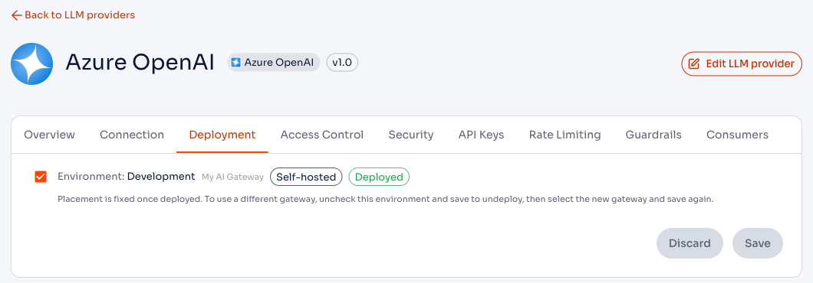
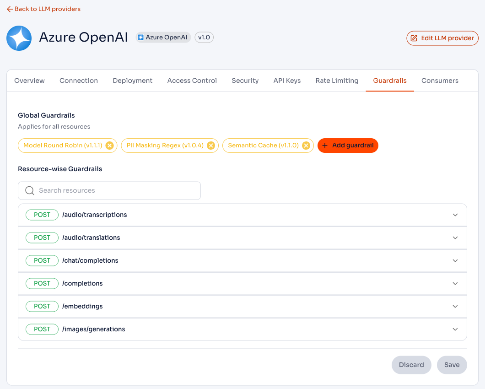
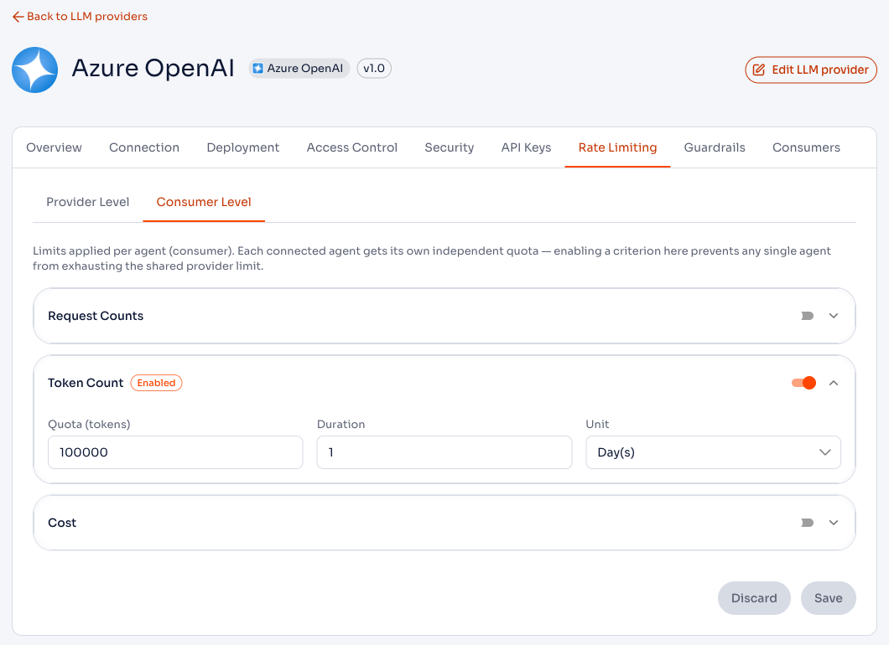

# Set up a governed multi-model LLM provider with cost controls and failover

## Overview

This guide shows you how to set up a single governed LLM provider that distributes requests across multiple models from the same provider, enforces per-team token budgets, and masks sensitive data before it leaves your network. Without this, any application can call any model without limits, costs are invisible until the invoice arrives, and a single overloaded model takes down every team at once. By the end, you will have a governed LLM provider with model round-robin, PII masking, and semantic caching deployed and verified against a live Azure OpenAI provider. A companion sample is available to run the full setup locally using Docker.

---

## Key Concepts

Before you start, here are the agent control plane terms this guide uses:

**Agent control plane** is the console where you manage AI-specific resources — LLM providers, gateways, and policies.

**LLM provider** is a connection to an external AI service such as OpenAI, Azure OpenAI, or Anthropic, and the managed endpoint your applications call. You configure credentials once, and the agent control plane manages authentication from that point on. The provider enforces the policies you attach — rate limits, guardrails, caching, and routing.

**AI gateway** is the runtime that hosts your LLM provider. You deploy the provider to a gateway to make it reachable.

**Token-based rate limit** is a policy that caps how many tokens an application or a bunch of applications/agents can consume in a given time window. This is how per-team budgets are enforced.

**Model Round Robin** is a guardrail that distributes requests across configured AI models in round-robin order to balance traffic and reduce overloading on any single model.

**PII masking** is a guardrail policy that detects and redacts/masks sensitive data — names, email addresses, credit card numbers — from prompts before they are forwarded to the provider.

**Semantic cache** is a policy that returns a cached response when an incoming prompt is semantically similar enough to a previously answered one, reducing provider calls, cost and the latency.

---

## Prerequisites

- An agent control plane account. [Sign up for free](https://console.cloud.choreolabs.com/agent-management/)
- An Azure OpenAI endpoint URL, an API key, and at least two model deployments
- A Mistral API key for embeddings, used for semantic caching in Step 1
- Docker and Docker compose
- `curl` for testing
- Latest `redis-stack-server`

---

## Architecture
In a collaborative effort to leverage AI efficiently, the Engineering, Product, and Sales teams have unified their access to large language models through a single, governed LLM provider. This setup ensures that, despite their different needs, all teams benefit from controlled costs, robust security, and reliable model access.

```
Your applications (engineering / product / sales teams)
    |  HTTPS + API key (per team)
    v
+---------------------------------------------+
|              LLM provider                   |
|  token budget · PII mask · semantic cache   |
+---------------------------------------------+
    |  round-robin across models
    v
+------------------+  +------------------+
|  OpenAI model A  |  |  OpenAI model B  |
+------------------+  +------------------+
```

All three teams use the same provider endpoint. The provider enforces each team's token budget, strips PII from prompts before they reach the model, serves cached responses when available, and distributes requests across models in round-robin order.

---
## Step 1: Create and start an AI gateway

The AI gateway is the runtime that hosts your provider and makes it reachable. If you already have a gateway running and it is shown as Active in the console, skip to the semantic caching settings below, because they are still required on your gateway.

**Create the gateway in the console:**

1. In the left navigation menu, under **Infrastructure**, click **Gateways**.
2. Click **Add gateway**.
3. Enter the following details:

    | Field | Value |
    |---|---|
    | **Display Name** | My AI Gateway |
    | **Name** | `my-ai-gateway` |
    | **Environment** | Select your environment. |
    | **Public URL** | `https://localhost:8443` |

4. Click **Create**.

!!! warning
    The console shows the gateway token only once, when you create the gateway. Run the command in step 3 of the setup panel before you close it.

**Start the gateway runtime:**

After you click **Create**, the console shows a **Set up My AI Gateway** panel with four steps for the **Docker** tab. Run them on the machine that hosts the gateway:

1. Download and unzip the gateway package with the command that the panel shows.
2. Open the unzipped directory, and run `./scripts/setup.sh`. The script creates the listener certificate, the at-rest encryption key, and the `api-platform.env` file. It prints the admin password once, so copy it.
3. Click **Copy** next to the third step, and run the command. It appends the control plane host and your gateway token to `api-platform.env`.
4. Start the gateway with `docker compose up`.

!!! note
    Semantic caching requires two core dependencies: a *vector database* and an embedding provider. For the vector database, this guide uses *Redis* — set up and run a Redis server before proceeding. For embeddings, this guide uses *Mistral*, though any of the following providers are supported

    - MISTRAL
    - OPENAI
    - AZURE_OPENAI

Once both are configured, populate the settings below and merge them into your gateway's main configuration file, located at `configs/config.toml` in the unzipped gateway directory. Place them before the first `[table]` header, because TOML requires root-level keys to come first.

```
embedding_provider = "MISTRAL" # Supported: MISTRAL, OPENAI, AZURE_OPENAI
embedding_provider_endpoint = "https://api.mistral.ai/v1/embeddings"
embedding_provider_model = "mistral-embed"
embedding_provider_dimension = 1024
embedding_provider_api_key = "<MISTRAL_API_KEY>"

vector_db_provider = "REDIS" # Supported: REDIS, MILVUS
vector_db_provider_host = "redis"
vector_db_provider_port = 6379
vector_db_provider_database = "0"
vector_db_provider_username = "default"
vector_db_provider_password = "default"
vector_db_provider_ttl = 3600
```

The gateway package doesn't include a Redis server. The semantic cache needs a Redis with the search module, so use the `redis/redis-stack-server` image. To run it next to the gateway, add the following service under `services` in the `docker-compose.yaml` file:

```yaml
  redis:
    image: redis/redis-stack-server:latest
    networks:
      - gateway-network
```

With this service, the host name `redis` in the settings resolves inside the gateway network. The Redis stack image has no password by default, so keep the username and password values only if your Redis server uses them.

Apply the changes after you save both files. In the unzipped gateway directory, run `docker compose up -d`. If you edited only `config.toml`, run `docker compose restart gateway-controller gateway-runtime` instead.

**Expected result:** The **Gateways** page shows your gateway with the **Active** and **Self-hosted** labels. Return here to continue.

The following image shows the **Gateways** page with the active self-hosted gateway:

{.cInlineImage-full}


## Step 2: Add Azure OpenAI as an LLM provider

You must register each provider's credentials in the agent control plane. The gateway uses these credentials to authenticate with the model service — your applications should never handle provider API keys directly.

**Add Azure OpenAI:**

1. In the left navigation menu, under **Resources**, click **LLM service providers**.
2. Click **Add service provider**.
3. Under **Basic Details**, enter the following values:

    | Field | Value |
    |---|---|
    | **Name** | Azure OpenAI |
    | **Version** | v1.0 |
    | **Context path** | `/azure-openai` |

4. Under **Provider Template**, select **Azure OpenAI**.
5. Under **Runtime Configuration**, enter your Azure OpenAI endpoint URL in **Endpoint URL**, and your key in **API key / Credential**.
6. Under **Deployment Configuration**, select the environment that your gateway belongs to. Open the gateway list that appears, and select **My AI Gateway**. The list defaults to the managed gateway, so change it.
7. Click **Add provider**.

**Expected result:** The provider page opens. The **Deployment** tab shows **My AI Gateway** with the **Deployed** status.

The following image shows the **Deployment** tab of the provider:

{.cInlineImage-full}


## Step 3: Configure model round-robin distribution

This guardrail distributes requests across models in round-robin order to balance traffic and reduce overloading on any single model.

1. On the provider detail page, click the Guardrails tab.
2. Under **Global Guardrails**, click **Add guardrail** and select Model Round Robin.
3. Expand models, and click **Add item**.
4. In **Model**, enter the name of the first Azure OpenAI deployment.
5. In **Provider**, enter the ID of this provider. The ID is the value after `/llm-providers/view/` in the page URL.
6. Click **Add item** again for each additional model and enter its name and the same provider ID. Repeat until you've added all the models you want to include in the rotation.
7. Click **Add to attach the guardrail**.
8. Click **Save** to save the changes.


**Expected result:** The Model Round Robin guardrail appears in the Guardrails tab as active. Requests are distributed across the models you configured in rotation. The **Deployment** tab shows **Deployed**.

!!! warning
    If you leave **Provider** empty, the gateway rejects the configuration, and the **Deployment** tab shows **Failed**.

!!! tip
    To automatically skip a model when it returns errors or rate limit responses, expand Advanced Settings and set a Suspend Duration in seconds before clicking Add.

## Step 4: Enable PII masking

PII masking strips sensitive data from prompts before they are forwarded to any provider. Names, email addresses, phone numbers, and other identifiers are replaced with anonymized placeholders — providers never see the original data.

1. On the provider detail page, click the Guardrails tab.
2. Under **Global Guardrails**, click **Add guardrail**.
3. Select PII Masking Regex from the guardrail list.
4. In the configuration panel, enable the following detection categories:
    - Email
    - Phone
    - Ssn
5. Keep the **Json Path** empty.
6. Click Add to attach the guardrail.
7. Click Save to save the changes.

**Expected result:** PII Masking appears in the Guardrails tab as active. Prompts containing any enabled category will have those values masked before leaving your network.


## Step 5: Enable semantic caching

Semantic caching returns a stored response when an incoming prompt is similar enough to a previously answered one. This reduces redundant provider calls and lowers cost — useful when teams frequently ask similar questions.

1. In the Guardrails tab, under **Global Guardrails**, click **Add guardrail**.
2. Select **Semantic Cache** from the policy list.
3. Set **Json Path** to `$.input`. For the chat completions API, use `$.messages[-1].content` instead.
4. Configure the Similarity threshold value as **0.92**
5. Click **Add** to attach the guardrail.
6. Click **Save** to save the changes.

**Expected result:** Semantic Cache appears in the **Guardrails** tab as active. Requests with a semantic similarity score above 0.92 to a cached prompt will receive the cached response without calling the provider.

The following image shows the **Guardrails** tab with Model Round Robin, PII Masking Regex, and Semantic Cache:

{.cInlineImage-full}

!!! note
    Without a **Json Path**, the cache compares the whole request body, which includes the `model` field. Model Round Robin changes that field on every request, so the same prompt never matches.

## Step 6: Set a token limit for each app

A consumer-level limit gives each app its own token quota, so one team can't use the tokens that other teams need.

1. On the provider page, open the **Rate Limiting** tab.
2. Select the **Consumer Level** sub-tab.
3. Expand **Token Count**, and turn on its switch.
4. Enter the following values:

    | Field | Value |
    |---|---|
    | **Quota (tokens)** | `100000` |
    | **Duration** | `1` |
    | **Unit** | `Day(s)` |

5. Select **Save**.

**Expected result:** The console displays **Rate limits updated successfully.** and **Token Count** shows **Enabled**.

{.cInlineImage-full}

## Step 7: Generate an API key

1. On the provider detail page, open the **API Keys** tab.
2. Click **Create API key**, enter a **Display name** (for example `test-key`), and click **Create**.
3. Copy the key immediately and store it securely — it's shown only once.
4. Open the **Overview** tab, and copy the **Invoke URL**.

**Expected result:** The API key is created and ready to use. The **Overview** tab also shows the provider's invoke URL.

---

## Verify

Use the API key and invoke URL from [Step 7](#step-7-generate-an-api-key) for all requests below.

!!! note
    Your Azure model name is the name of one of your Azure OpenAI deployments.

**Confirm the provider is reachable:**

Send a request with your API key:

```
curl -k -v -X POST \
"<INVOKE-URL>/responses?api-version=<API-VERSION>" \
  -H "Content-Type: application/json" \
  -H "API-Key: <API-KEY>" \
  -d '{
    "model": "<AZURE-MODEL-NAME>",
    "input": "What is the capital of France?"
  }'
```

**Expected response:** HTTP `200` with a response object. The answer appears in `output[0].content[0].text`. The provider distributes the request to the next model in the rotation.

**Confirm unauthenticated requests are rejected:**

Send a request without an API key:

```
curl -k -v -X POST <INVOKE-URL>/responses \
-H "Content-Type: application/json" \
   -d '{"model": "<YOUR-AZURE-DEPLOYMENT-NAME>", "input": "Hello"}'
```

**Expected response:** HTTP `401 Unauthorized`.

**Confirm Semantic Caching:**

1. Send a request with a sample prompt 

```
curl -k -v -X POST <INVOKE-URL>/responses \
  -H "Content-Type: application/json" \
  -H "API-Key: <YOUR-API-KEY>" \
  -d '{
    "model": "<YOUR-AZURE-DEPLOYMENT-NAME>",
    "input": "Hello !!"
  }'
```

2. Resend the same request and check the http response headers

**Expected result:** The second response is served from the cache, indicated by the `X-Cache-Status: HIT` header.


**Confirm PII masking is active:**

Ask the model to spell out the value it received, so the gateway can't restore it:

```
curl -k -v -X POST <INVOKE-URL>/responses \
  -H "Content-Type: application/json" \
  -H "API-Key: <YOUR-API-KEY>" \
  -d '{
    "model": "<YOUR-AZURE-DEPLOYMENT-NAME>",
    "input": "Write the exact token after the word email: in this text with a hyphen between every character, and no other words. email: john.doe@example.com"
  }'
```

**Expected result:** The response spells out a placeholder such as `[EMAIL_0000]` instead of the email address. The model might omit the brackets.

---

## Troubleshooting
| Symptom | Resolution |
|---|---|
|HTTP `401 Unauthorized` on every request| Confirm the API-Key header is present and the key was generated from this provider's API Keys tab. |
| HTTP `503 Service Unavailable` | All models in the round-robin list are suspended. Wait for the suspend duration to expire or check provider status. | 
| `HTTP 500` on every request after you add **Semantic Cache** | Confirm that the embedding provider and vector database settings from Step 1 are in `config.toml` and that the gateway runtime restarted. Confirm that Redis is reachable from the gateway. |
| `HTTP 500` and the runtime log shows `Policy chain not found for route` | The semantic cache can't reach Redis, so the gateway drops the policy chain for the route. Search `docker compose logs gateway-runtime` for `Failed to build policy chain`. Confirm that the `redis` service runs on the gateway network and that the host in `config.toml` matches. |
| Requests succeed, but the second request never returns `X-Cache-Status: HIT` | The embedding provider API key in `config.toml` might be wrong. A wrong key disables the semantic cache silently, with no error. Confirm the key, and restart the gateway runtime. |
| The **Deployment** tab shows **Failed** | Check the gateway logs with `docker compose logs gateway-controller`. If you see `models.0.provider: String length must be greater than or equal to 1`, fill in **Provider** for every **Model Round Robin** item. Otherwise, remove the guardrail you added last, select **Save**, and check whether the status returns to **Deployed**. |
| Provider not reachable after deployment | Confirm the gateway shows **Active** on the **Gateways** page and the **Deployment** tab shows **Deployed**. |
| PII not being masked | Confirm PII Masking is in the Guardrails tab and that you clicked Save. |
| Provider connection failing | Confirm the provider's endpoint URL and API key are valid. Open the provider's **Connection** tab to review them. |

---

## What You Learned

- Set up a single governed LLM provider so applications never call the model service directly
- Distributed requests across Azure OpenAI models in round-robin order to balance traffic and reduce overloading on any single model
- Masked PII from prompts before they leave your network using email, phone, and SSN detection categories
- Reduced redundant provider calls with semantic caching at a 0.92 similarity threshold, verified using the `X-Cache-Status: HIT` header
- Capped token usage for each app with a consumer-level token limit

---

## Next Steps

**Add prompt injection protection and OWASP coverage** — extend the guardrail configuration with additional security policies to protect against prompt injection and other LLM-specific threats

**Semantic caching deep-dive with cost comparison** — tune similarity thresholds and measure the cost reduction from caching across your traffic

---

## Try the sample

The companion sample runs this setup end to end using Docker, demonstrating model round-robin, PII masking, and semantic caching against an OpenAI-compatible endpoint.

[View the sample on GitHub](https://github.com/wso2/api-platform/tree/main/samples/llm-cost-control-and-privacy-control).
